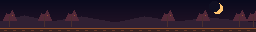

# Turkey Chase

A 13-second, 256 × 32 pixel animation for three LED panels ordered **64 → 128 → 64**. The turkey stops at the middle of the center panel and fans its tail. A musket flash sends feathers flying, and the chase exits at the far right.

[Download the Python card](addons/turkey_chase.py)

Synchronized playback requires a Pixora LED Studio build with custom display-group playback support. In that build, import the Python file in **My Apps**, select the matching display group in the card options, and press **Test** to play the scene once. Standard single-display previews show a still frame.
